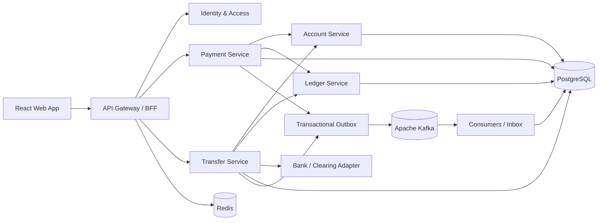
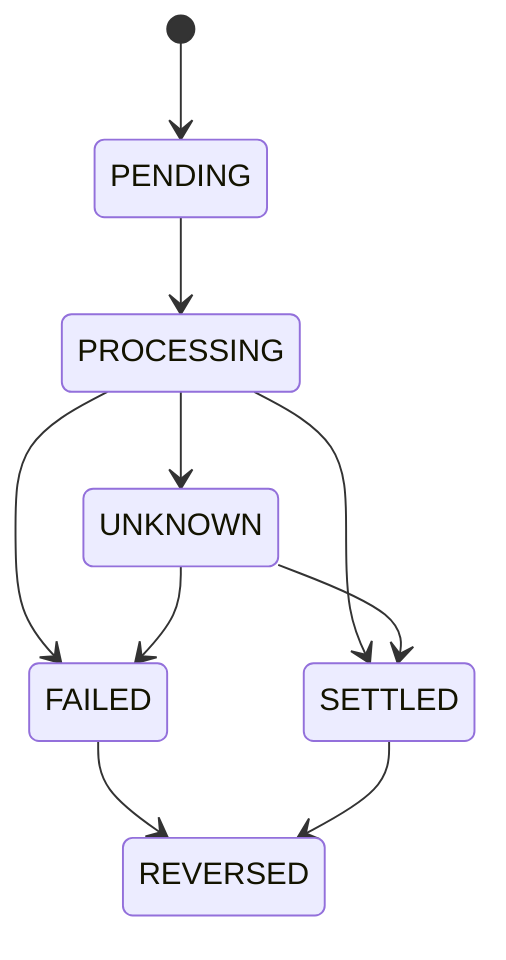

# Banking Transactions Platform

Nền tảng mẫu cho các nghiệp vụ ngân hàng số: thanh toán, chuyển tiền nội bộ và chuyển tiền liên ngân hàng. Hệ thống được định hướng theo kiến trúc microservices với Java Spring Boot, React, PostgreSQL, Apache Kafka và Redis.

> Đây là thiết kế tham khảo để học tập và phát triển sản phẩm. Không nên dùng trực tiếp để xử lý tiền thật nếu chưa hoàn tất kiểm thử độc lập, đánh giá an toàn, tích hợp hệ thống thanh toán được cấp phép, quản lý khóa/HSM và đáp ứng các yêu cầu pháp lý, tuân thủ tại thị trường triển khai.

## Tên dự án GitHub

**Repository:** `banking-transactions-platform`  
**Mô tả ngắn:** `A secure, event-driven banking transactions platform for payments and interbank transfers.`

Tên này dễ hiểu, mô tả đúng phạm vi hiện tại và phù hợp để mở rộng thêm các nghiệp vụ tài khoản, sổ cái và đối soát.

## Mục tiêu

- Cung cấp API cho thanh toán và chuyển tiền.
- Bảo đảm mỗi giao dịch tài chính được ghi sổ nhất quán bằng bút toán kép.
- Chống xử lý trùng khi client hoặc Kafka gửi lại yêu cầu/sự kiện.
- Xác thực và kiểm tra tính toàn vẹn của thông điệp giữa các service.
- Hỗ trợ xử lý bất đồng bộ, truy vết trạng thái và đối soát.
- Tách biệt rõ trạng thái giao dịch với trạng thái bút toán và trạng thái tích hợp bên ngoài.

## Công nghệ dự kiến

| Thành phần | Công nghệ | Trách nhiệm |
|---|---|---|
| Web client | React + TypeScript | Giao diện khách hàng và vận hành |
| Backend | Java, Spring Boot | API và các domain service |
| Cơ sở dữ liệu | PostgreSQL | Dữ liệu giao dịch, tài khoản, sổ cái, outbox/inbox |
| Message broker | Apache Kafka | Phát sự kiện và giao tiếp bất đồng bộ |
| Cache / ephemeral state | Redis | Rate limiting, cache dữ liệu không trọng yếu, khóa ngắn hạn có TTL |
| Quan sát hệ thống | OpenTelemetry + Prometheus/Grafana (dự kiến) | Metrics, tracing, dashboard và cảnh báo |
| Triển khai | Docker Compose cho local; Kubernetes tùy môi trường | Đóng gói và vận hành |

PostgreSQL là nguồn dữ liệu chuẩn cho số dư/sổ cái. Redis không được dùng làm nguồn duy nhất cho số dư hoặc trạng thái giao dịch tài chính.

## Kiến trúc mức cao

Trong giai đoạn đầu, các service có thể nằm trong một modular monolith Spring Boot để giảm chi phí vận hành, nhưng vẫn phân chia module theo domain và giữ ranh giới dữ liệu rõ ràng. Chỉ tách thành microservices khi có nhu cầu triển khai, mở rộng hoặc phân quyền vận hành độc lập.

### Các domain/service chính

- **Identity & Access:** xác thực người dùng, phân quyền, MFA/step-up authentication và quản lý phiên.
- **Payment:** nhận yêu cầu thanh toán, kiểm tra chính sách và điều phối giao dịch.
- **Transfer:** quản lý chuyển tiền nội bộ/liên ngân hàng và vòng đời giao dịch.
- **Account:** tài khoản, trạng thái tài khoản, hạn mức và kiểm tra khả dụng.
- **Ledger:** ghi sổ kép bất biến; tính số dư từ các bút toán hoặc projection đã kiểm soát.
- **Bank/Clearing Adapter:** chuyển đổi giao thức nội bộ sang giao thức của đối tác hoặc mạng thanh toán.
- **Notification:** gửi thông báo theo sự kiện; không quyết định kết quả tài chính.
- **Reconciliation:** đối chiếu trạng thái nội bộ với sao kê/kết quả từ đối tác.

## Flow chuyển tiền

### 1. Nhận yêu cầu và chống gửi trùng

1. Người dùng đăng nhập; hệ thống kiểm tra quyền và yêu cầu MFA/step-up khi chính sách rủi ro cần.
2. Client gửi yêu cầu qua API Gateway, kèm `Idempotency-Key` duy nhất cho thao tác.
3. Transfer Service xác thực dữ liệu, kiểm tra hạn mức, trạng thái tài khoản và quyền thực hiện.
4. Service ghi nhận yêu cầu cùng khóa idempotency vào PostgreSQL trong transaction. Cùng khóa và cùng nội dung trả lại kết quả đã lưu; cùng khóa nhưng nội dung khác bị từ chối.
5. Mọi thời điểm và số tiền được chuẩn hóa; số tiền dùng kiểu decimal chính xác, không dùng floating point.

### 2. Chuyển tiền nội bộ

1. Transfer Service tạo giao dịch với trạng thái ban đầu `PENDING`.
2. Trong một transaction PostgreSQL, Ledger Service ghi các bút toán kép cân bằng: ghi nợ tài khoản nguồn và ghi có tài khoản đích. Nếu cần kiểm tra số dư đồng thời, khóa/cập nhật có điều kiện trên bản ghi tài khoản hoặc dùng cơ chế tuần tự hóa phù hợp.
3. Cùng transaction đó, ghi sự kiện vào bảng outbox. Không publish Kafka trước khi transaction cơ sở dữ liệu commit.
4. Outbox publisher phát `TransferCompleted` lên Kafka. Consumer lưu `eventId` vào inbox có unique constraint trước khi áp dụng side effect; sự kiện gửi lại không được xử lý lần hai.
5. API trả trạng thái giao dịch và mã tham chiếu. Notification Service chỉ gửi thông báo sau khi nhận sự kiện đã commit.

### 3. Chuyển tiền liên ngân hàng

1. Thực hiện các bước xác thực, idempotency, hạn mức và kiểm tra rủi ro như flow chung.
2. Trong transaction PostgreSQL, tạo giao dịch `PENDING`, ghi bút toán giữ tiền (hold/reservation) hoặc bút toán theo mô hình đã chọn, và thêm thông điệp gửi đi vào outbox.
3. Adapter tiêu thụ yêu cầu và gửi đến đối tác/mạng thanh toán với mã tham chiếu ổn định. Không giữ transaction DB mở trong lúc gọi mạng bên ngoài.
4. Phản hồi đồng bộ hoặc callback/webhook được xác thực, đối chiếu với mã tham chiếu, rồi chuyển giao dịch sang `SETTLED` hoặc `FAILED`. Callback lặp lại phải idempotent.
5. Nếu timeout hoặc không rõ kết quả, giữ trạng thái `PENDING`/`UNKNOWN` để truy vấn hoặc đối soát; không tự kết luận thất bại và hoàn tiền chỉ vì hết thời gian chờ.
6. Khi thất bại được xác nhận, ghi bút toán giải phóng hold/hoàn trả bằng một bút toán mới; không sửa/xóa bút toán cũ.
7. Đối soát định kỳ xử lý trường hợp phản hồi bị mất, trạng thái lệch hoặc giao dịch treo.

`REVERSED` là nghiệp vụ bù trừ bằng bút toán mới, không phải xóa hay chỉnh sửa lịch sử ledger. Chuyển trạng thái phải được kiểm soát bằng state machine; danh sách trên là khung tham khảo và cần tinh chỉnh theo quy tắc của từng mạng thanh toán.

## Chữ ký số giữa các service

Chữ ký số xác thực nguồn gửi và tính toàn vẹn của thông điệp; nó không thay thế TLS, phân quyền, xác thực nghiệp vụ hoặc idempotency.

- Dùng TLS cho mọi kết nối; ưu tiên mTLS cho giao tiếp service-to-service.
- Với thông điệp cần chữ ký ở tầng ứng dụng, ký payload canonical có phiên bản, tối thiểu gồm `messageId`, `eventId`, `eventType`, `createdAt`, `expiresAt`, `sender`, `correlationId` và hash của payload.
- Chọn thuật toán/chính sách chữ ký phù hợp với chuẩn của tổ chức; khóa riêng phải lưu trong KMS/HSM, không lưu trong source code, image, log hoặc Redis.
- Consumer kiểm tra chữ ký, danh tính service gửi, thời hạn thông điệp, quyền phát event và trạng thái thu hồi/phiên bản khóa.
- Chống replay bằng `messageId`/`eventId` có unique constraint trong inbox, kết hợp cửa sổ thời gian hợp lý. Redis có thể hỗ trợ cache replay ngắn hạn nhưng ràng buộc duy nhất bền vững vẫn cần ở PostgreSQL.
- Có quy trình cấp phát, luân chuyển, thu hồi khóa và xử lý sự cố; không tự thiết kế thuật toán mật mã.

## Nguyên tắc dữ liệu và độ tin cậy

- **Ledger bất biến, bút toán kép:** tổng ghi nợ phải bằng tổng ghi có cho mỗi journal; mọi điều chỉnh thực hiện qua bút toán đảo/bù trừ.
- **Không giả định exactly-once:** Kafka thường được xử lý theo hướng at-least-once; bảo đảm hiệu ứng đúng một lần ở cấp nghiệp vụ bằng idempotency và inbox/outbox.
- **Transactional outbox/inbox:** giữ nhất quán giữa commit DB và publish/consume Kafka.
- **Kiểm soát đồng thời:** định nghĩa rõ cách ngăn chi vượt số dư trong các giao dịch song song; kiểm thử race condition ở mức DB.
- **Tách số dư khả dụng và số dư sổ cái:** hold, pending và settled cần mô hình rõ ràng.
- **Audit trail:** lưu người/ứng dụng thực hiện, thời điểm, correlation ID và thay đổi trạng thái; không ghi thông tin xác thực nhạy cảm hoặc dữ liệu thẻ không cần thiết.
- **Bảo vệ dữ liệu:** mã hóa khi truyền và khi lưu, quản lý bí mật tập trung, giới hạn quyền truy cập, chính sách lưu giữ và xóa dữ liệu theo quy định.
- **Vận hành:** có timeout, retry có backoff, dead-letter queue, cảnh báo giao dịch treo, tracing xuyên service, backup và diễn tập khôi phục.

## API dự kiến

| Method | Endpoint | Ý nghĩa |
|---|---|---|
| `POST` | `/api/v1/transfers` | Tạo yêu cầu chuyển tiền; yêu cầu `Idempotency-Key` |
| `GET` | `/api/v1/transfers/{transferId}` | Tra cứu trạng thái và mã tham chiếu |
| `POST` | `/api/v1/payments` | Tạo yêu cầu thanh toán |
| `GET` | `/api/v1/accounts/{accountId}/balance` | Tra cứu số dư theo quyền được cấp |
| `POST` | `/api/v1/integrations/{partner}/callbacks` | Nhận callback đã xác thực từ đối tác |

API thực tế cần xác định schema, xác thực/ủy quyền, giới hạn tần suất, phiên bản, chuẩn lỗi và quy tắc phân quyền theo chủ tài khoản trước khi triển khai.

## Bắt đầu phát triển

Repository hiện là bản thiết kế khởi đầu. Khi bổ sung mã nguồn, nên cung cấp các file cấu hình local không chứa bí mật (ví dụ `.env.example`) và Docker Compose cho PostgreSQL, Kafka, Redis cùng các service.

Hướng dẫn chạy sẽ được cập nhật tại đây sau khi có mã nguồn và cấu hình môi trường. Không đưa mật khẩu, khóa ký, token hoặc dữ liệu ngân hàng thật vào repository.

## Lộ trình gợi ý

1. Chốt domain model, state machine, quy tắc số dư và chính sách idempotency.
2. Tạo backend Spring Boot với migration PostgreSQL và kiểm thử ledger/đồng thời.
3. Hoàn thiện transactional outbox/inbox và tích hợp Kafka.
4. Bổ sung xác thực người dùng, MFA, phân quyền và chữ ký/mTLS service-to-service.
5. Xây dựng React UI cho giao dịch, lịch sử và tra cứu trạng thái.
6. Tích hợp adapter sandbox, xử lý callback và job đối soát.
7. Bổ sung quan sát hệ thống, kiểm thử tải, kiểm thử khôi phục và đánh giá bảo mật độc lập.

## Đóng góp

Đề xuất thay đổi nên bao gồm mô tả nghiệp vụ, ảnh hưởng đến ledger/state machine, kiểm thử idempotency và xử lý lỗi. Không gửi dữ liệu khách hàng, thông tin tài khoản thật hoặc bí mật vận hành lên issue/pull request.
